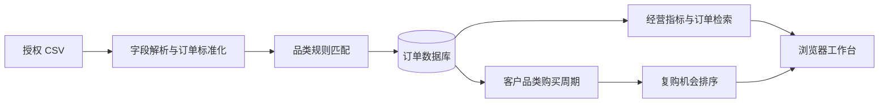

# Commerce Insight · 知购

**订单分析与复购洞察工作台**


将授权导出的跨平台订单转换为统一的经营视图：导入 CSV、自动归类、检索订单，并按客户购买节奏识别复购机会。使用可解释规则建立分类与排序基线，保留后续替换模型的实现边界。

[快速开始](#快速开始) · [使用手册](docs/user-guide.md) · [架构与数据流](docs/architecture.md) · [开发说明](CONTRIBUTING.md)

## 核心能力

| 模块 | 已实现能力 |
| --- | --- |
| 订单接入 | CSV 字段标准化；按「平台 + 订单号」识别重复订单 |
| 经营总览 | 订单数量、近 30 天销售额、成交客户与品类分布 |
| 品类识别 | 商品名称关键词匹配，保留命中理由与规则分值 |
| 订单检索 | 按商品、客户、订单号搜索，支持品类和平台筛选接口 |
| 复购洞察 | 按客户与品类计算购买间隔、周期临近程度和候选排序 |
| 数据存储 | SQLAlchemy 数据层；默认 SQLite，可配置 MySQL |

## 工作流程



## 快速开始

需要 **Python 3.10+**。在 Windows PowerShell 中执行：

```powershell
git clone https://github.com/keke152/commerce-insight.git
cd commerce-insight
.\start.bat
```

首次运行会建立虚拟环境、安装依赖，并生成虚构演示订单。浏览器打开 **http://127.0.0.1:8000**，保持服务窗口运行。

其他平台可在项目根目录创建 Python 虚拟环境，安装 `requirements.txt`，再运行：

```bash
python -m uvicorn app:app --host 127.0.0.1 --port 8000
```

### 体验一个完整流程

1. 查看经营总览及品类分布。
2. 导入仓库中的 `sample_orders.csv`，观察订单与复购清单更新。
3. 重复导入同一文件，查看去重结果。
4. 搜索客户或商品，结合购买次数、平均周期和最近购买日期解释复购排序。

## 项目结构

```text
commerce-insight/
├── app.py                # 接口、数据模型、导入与分析逻辑
├── static/               # 中文工作台与浏览器交互
├── docs/                 # 使用手册、架构和后续计划
├── sample_orders.csv     # 虚构样例订单
├── .env.example          # 数据库配置示例
├── requirements.txt      # 固定版本依赖
└── start.bat             # Windows 启动入口
```

## 文档

| 文档 | 内容 |
| --- | --- |
| [使用手册](docs/user-guide.md) | 数据字段、接口、MySQL 配置与操作讲解 |
| [架构与数据流](docs/architecture.md) | 模块职责、去重方式、规则分数与运行数据 |
| [后续计划](docs/roadmap.md) | 数据接入、模型评估及服务化方向 |
| [开发与贡献](CONTRIBUTING.md) | 本地开发、问题反馈与文档约定 |

## 实现范围

- 默认数据是虚构样例；当前通过 CSV 导入订单，尚未接入真实电商平台。
- 分类和复购使用规则基线，分值用于解释和排序，不是经过校准的购买概率。
- 当前面向本地使用；多租户鉴权、数据库迁移及平台增量同步列入[后续计划](docs/roadmap.md)。
