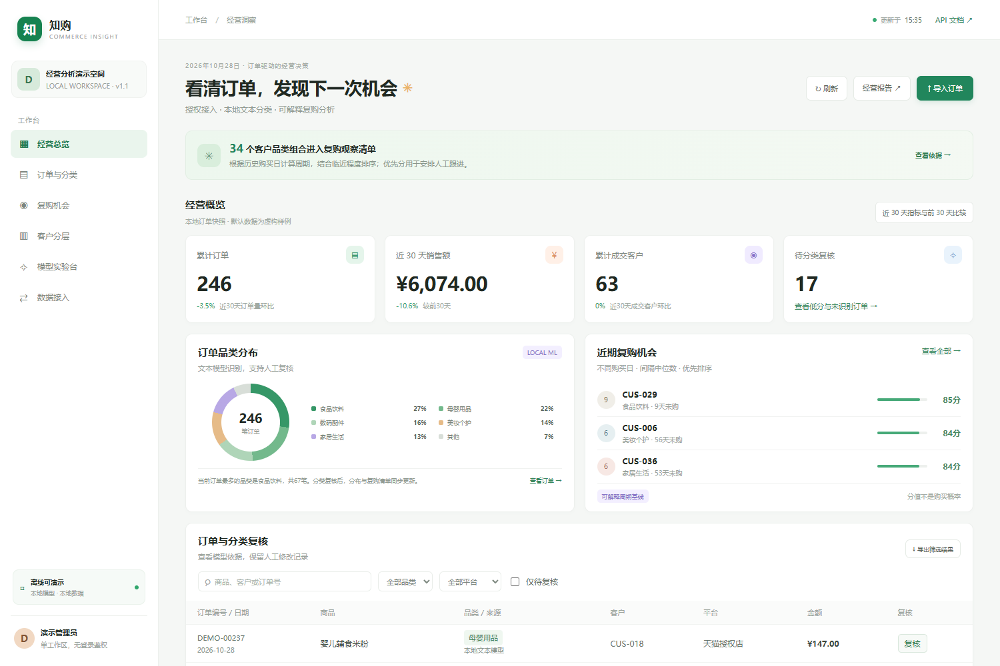

# Commerce Insight · 知购

**授权订单接入、商品分类与复购洞察工作台 · v1.1.0**


面向电商经营场景，把客户授权导出的订单整理为统一视图：预检 CSV、文本模型分类、人工复核、客户分层、复购机会排序及报告导出。安装依赖后可离线演示，无需模型 API Key。



[使用手册](docs/user-guide.md) · [架构与数据口径](docs/architecture.md) · [模型说明](docs/model-card.md) · [面试演示与问答](docs/interview-guide.md)

## 功能

| 模块 | 已实现能力 |
| --- | --- |
| 授权订单接入 | 标准英文 / 常见中文字段映射，UTF-8 / GB18030，8 MB / 10,000 行限制 |
| 导入质量控制 | 预检不写库、错误行定位、授权声明、文件 SHA256 校验、事务写入、两级去重、批次记录 |
| 本地商品分类 | 字符 TF-IDF + 逻辑回归；6 类；真实训练与推断；可查看文本特征、分值和模型说明 |
| 人工复核 | 待复核筛选、修改或确认分类、保留原模型结果与复核记录 |
| 经营看板 | 实际订单统计、真实计算的30天环比、品类分布、分页与平台筛选 |
| 客户洞察 | R/F/M 固定规则分层、购买日间隔中位数、复购优先排序及原因解释 |
| 导出 | 按筛选条件导出全部订单 CSV，复购清单 CSV，独立 HTML 经营报告 |

## 快速开始

需要 **Python 3.10–3.13**。Windows 双击 `start.bat`，或手动运行：

```powershell
py -3.10 -m venv .venv
.\.venv\Scripts\python -m pip install -r requirements.txt
.\.venv\Scripts\python -m uvicorn app:app --host 127.0.0.1 --port 8000
```

浏览器打开 [本机工作台](http://127.0.0.1:8000)，首次启动生成240条虚构订单。运行数据默认保存在 `runtime/commerce.db`；检测到旧版根目录 `demo.db` 时继续使用旧库，只添加新表，不改写原分类。旧记录在界面标为“历史记录”。

### 5分钟体验

1. 查看总览、待复核数、真实环比和客户分层。
2. 导入 `sample_orders_cn.csv`，查看中文字段映射、预检及分类结果。
3. 填写“虚构样例”来源，确认授权声明并导入；重复导入验证去重。
4. 筛选“仅待复核”，人工确认一个分类，观察总览和复购清单更新。
5. 在模型实验台输入商品名称，查看分值、特征和模型限制。
6. 打开经营报告，或导出订单及复购清单。

## 验证

```powershell
.\.venv\Scripts\python -m pip install -r requirements-dev.txt
.\.venv\Scripts\python -m unittest discover -s tests -v
node --check static/app.js
```

测试使用临时数据库，不接触实际运行数据。覆盖输入校验、授权拦截、重复导入、事务完整性、文件摘要、分类复核、全量导出及周期计算。CI 配置 Python 3.10 / 3.12。

## 项目结构

```text
app.py                  Uvicorn 兼容入口
server.py               HTTP、数据表、事务与报告
classification.py       文本模型训练、推断与样例评测
ingestion.py            CSV 映射、校验及文件内去重
insights.py             客户分层与复购周期排序
data/catalog.json       虚构商品训练集与独立测试集
static/                 中文工作台，无外部字体或脚本
tests/                  临时库自动化测试
docs/                   使用、架构、模型与面试演示文档
sample_orders*.csv      虚构标准/中文订单
```

## 实现范围

- 当前通过授权导出 CSV 接入；没有登录、爬取真实平台，也没有平台官方 API 连接器。
- 分类是真实运行的本地机器学习模型；不是大模型 Agent。96条训练、24条独立测试均为人工编写的虚构商品，评测不代表真实业务效果。
- 复购使用可解释周期规则，优先分不是购买概率；人工修改只影响当前分析，不自动训练。
- 默认订单均为虚构数据。用户导入后可能混合自己的数据，报告应结合实际来源解释。
- `customer_id` 必须是商家已统一的客户ID；不同平台原始编号需事先映射，或加平台前缀避免误合并。
- 面向本地单工作区；没有登录鉴权、租户隔离和真实自动营销。请绑定 `127.0.0.1` 运行。
- SQLAlchemy 支持配置 MySQL，本次自动化验证使用 SQLite；MySQL 端到端兼容性尚未实测。

更多设计取舍见[架构](docs/architecture.md)、[后续计划](docs/roadmap.md)及[更新记录](CHANGELOG.md)。
