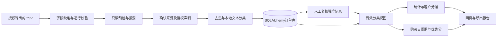

# 架构、数据口径与实现边界



## 模块

`app.py` 提供兼容启动入口；`server.py` 实现 FastAPI、SQLAlchemy 表及接口；`ingestion.py` 负责 CSV 解析；`classification.py` 实现模型；`insights.py` 是独立、可测试的客户与复购计算。

表结构：`orders` 保留旧版字段及 `(platform, order_id)` 唯一约束；`category_reviews` 追加复核事件，读取最大ID为有效结果；`import_batches` 与订单在同一个事务里写入授权声明、来源、SHA256及数量。

## 预检与事务

1. 限制读取8MB+1字节，解码并映射表头，逐行校验。
2. 校验有效后按文件内键去重，读取数据库键计算已有重复。
3. 预检只返回信息，不存储上传原文件或改变数据库。
4. 提交时重新读取文件、计算摘要和验证数据；存在任何无效行则拒绝整个批次。
5. 对唯一新增行执行分类，事务写入订单和批次。若并发冲突，整批回滚，返回409供重新预检。

当前不采用任务队列、增量游标或订单状态覆盖。文件内同键不同内容也按重复跳过，业务需先在源数据中消除冲突。

## 客户身份

订单按平台去重，客户分析按 `customer_id` 聚合。样例数据使用统一客户ID，因此可以跨平台分析。真实平台ID不能直接视为同一个人；应由商家授权的客户主数据映射，或者给不同平台ID添加前缀以避免误合并。当前没有自动身份识别。

## 复购周期

对每个客户与有效品类分组，排除“其他”，将同日多笔订单合为一个购买日。至少两个购买日才计算周期：

```text
cycle = max(7, round(median(相邻不同购买日间隔)))
ratio = 距上次购买天数 / cycle
ratio >= 0.65 时进入候选
score = clip(round(85 - abs(ratio - 1) * 25 + min(购买日数 - 2, 4) * 2), 5, 95)
```

`ratio < 1` 为即将复购，1至2为建议触达，大于2为需唤回评估。越久没买不等于购买概率越高，因此过度逾期会降分。保留 `likelihood` 字段仅为旧版接口兼容，新页面使用 `priority_score`，显示“分”而非“%”。没有训练复购预测模型，也没有时间切分业务回测。

## 客户分层规则

依次判断，第一条命中生效：

1. R≤60天、F≥3个购买日且M≥500元：高价值活跃。
2. R>90天：待唤回。
3. F=1：新客户。
4. 其他：成长客户。

这是一套固定的 R/F/M 规则，不是分位数RFM评分或学习得到的聚类模型。

## 演示和生产的差距

当前为本地单工作区，所有数据库读取和分析主要在进程内完成。生产仍需用户/租户鉴权、数据库迁移与备份、异步导入、官方平台API鉴权、分页增量同步、限流重试、退款/取消建模、正式模型数据集及时间回测。不能把当前CSV处理声称为已完成的真实平台爬虫。
